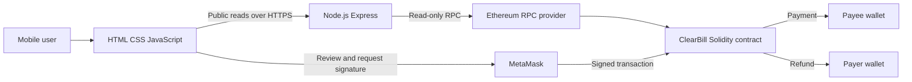
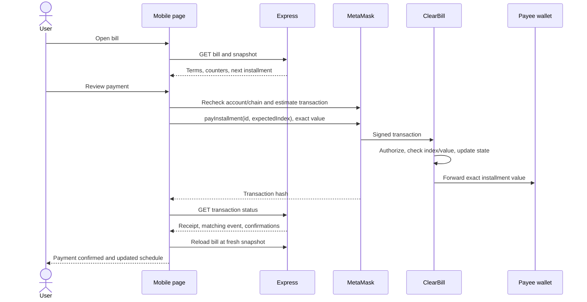

# ClearBill System Architecture

Status: planned architecture. No component has been implemented or deployed.

## Components and trust boundaries

The browser owns presentation, input assistance and transaction tracking. MetaMask owns keys and signing. The contract owns financial permissions and lifecycle. Express owns HTTP validation, public chain queries, receipt interpretation and bounded read pagination. The RPC provider is an availability and read-integrity dependency; it is not a signing authority.

Express serves static pages and `/api/v1` from the same origin. There is no separate frontend deployment, application database, queue, scheduler, event subscription worker or microservice. Polling occurs only while a submitted transaction is actively being checked. Normal page reads refresh on entry, explicit refresh and successful actions.

## Module ownership

| Component | Owns | Must not own |
| --- | --- | --- |
| `contracts/ClearBill.sol` | Immutable bill terms, counters, permissions and events | HTTP, presentation, off-chain profiles |
| `server/chain.js` | RPC reads, snapshot validation, log decoding, receipt verification | Wallet secrets or transaction signing |
| `server/routes.js` | Endpoint input/output and error translation | Duplicate financial rules or a shadow ledger |
| `public/js/wallet.js` | Provider detection, selected address and chain change handling | User keys or silent account selection |
| `public/js/transactions.js` | Review/sign/wait/reconcile workflow | Declaring payment success from an unverified hash |
| Page scripts | Page state, filters, display and interaction | Authorizing contract actions |

Frontend validation improves feedback; the contract independently enforces financial rules. Backend projections derive outstanding and overdue from stored contract values at a specified snapshot. They do not mutate the financial state.

## Payment sequence

HTTP reads are not part of the atomic financial transaction. A successful chain transaction remains successful if Express becomes unavailable; the UI retains the hash and later reconciles it.

## Snapshot reads and pagination

Each multi-request list or dashboard starts at one block number and hash. The backend uses that block tag for all contract reads and verifies its hash before and after each response's read batch. The snapshot timestamp drives overdue calculations. A changed canonical hash returns `SNAPSHOT_CHANGED`; the client discards that aggregate and starts a fresh read.

Account bills are paged through on-chain per-address indexes, 20 by default and at most 50. List filters apply to loaded bills; until all pages are read, the screen must state that results cover loaded bills only. Dashboard totals remain labelled as loading or partial until both relevant account lists have been completely read at the same snapshot. Do not silently cap totals or show an incomplete total as final.

History scans events backwards in bounded block windows from the snapshot to the deployment block. Both payee and payer event filters are queried and deduplicated by chain, contract, transaction hash and log index. A window with no matches still returns a cursor if older blocks remain. Timestamp filtering can stop a backwards scan once all older blocks precede the requested start time; no window may be skipped merely because its first query is empty.

This design trades additional RPC reads for simpler storage. Repeated reads can be slow on old deployments; record actual latency. Persistent indexing is a future improvement, not a hidden dependency.

## Deployment and environment

Use a local test chain during development, Sepolia for live evidence and Render for one HTTPS Node service. Version and dependency pins are selected and recorded in the initial tooling phase. No paid service is required by the design; any paid plan requires an explicit choice before purchase.

The checked-in deployment manifest contains only `chainId`, `contractAddress`, `deploymentBlock`, `deploymentTransactionHash` and compiler/build identifiers. It is created only after verifying a real deployment receipt. At startup, the backend checks chain ID, nonempty deployed code, manifest block and the expected artifact/runtime identity. ABI and manifest must come from the same build. A mismatch disables application reads with a setup error rather than falling back to another chain.

The browser verifies MetaMask's chain before a transaction. Missing configuration produces a setup screen with no active payment buttons. No placeholder deployment address is treated as usable.

## Rollback and failure behavior

Rolling back frontend/backend code does not roll back chain state. Never replace a deployed contract in configuration without stating that it is a new ledger. This release has no upgrade or migration path. Existing bills remain readable through their original contract; any future replacement requires a separately designed migration policy.

For an urgent UI issue, the operator may take the website offline. This does not pause the contract or stop direct calls. RPC failures return explicit errors; there is no fake local ledger or silent network fallback.

Log route name, HTTP status, duration and a sanitized error code. Do not log credential-bearing RPC URLs, labels, wallet signatures or complete wallet payloads. Health checks distinguish process availability from chain readiness.

## Reference use

Existing course repositories informed workload comparison only. ClearBill's contract API, data schema, UI and file responsibilities are designed for the accepted bill workflow. Multiple business contracts, dispute resolvers, role registries and financing pools are excluded. There is no copied reference implementation or shared dependency on another student's service.
