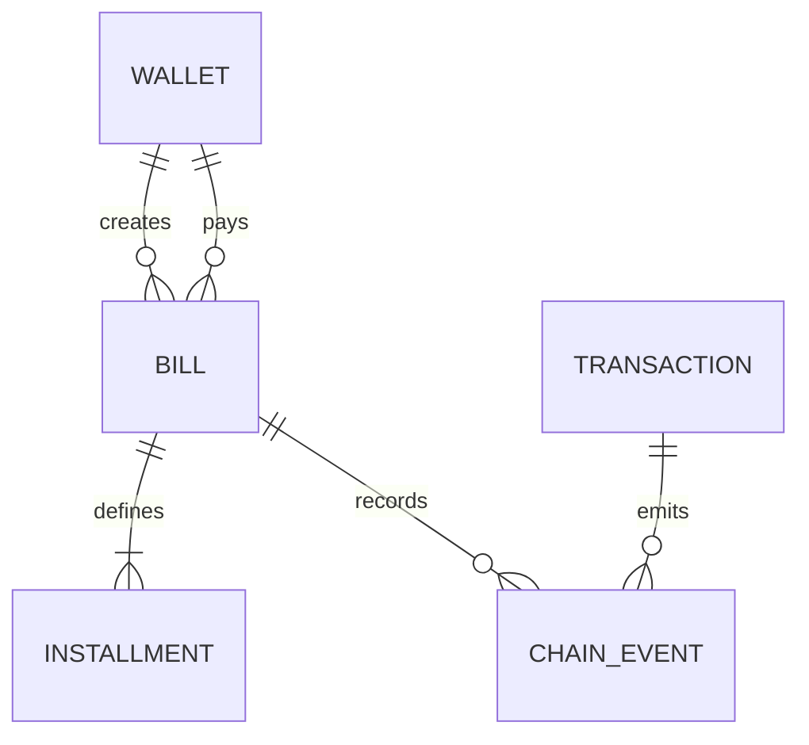

# ClearBill Data and Storage Design

Status: on-chain records and browser recovery storage implemented locally. No application database is used.

## Database decision

The initial release does not use SQLite, MongoDB or another application database. All durable business data fits the Solidity bill record and event history. Adding a database would introduce synchronization, persistence and recovery responsibilities without providing a required feature.

This document serves as the database and data design: it defines the actual storage owners, logical relationships, indexes, lifecycle and read projections. No empty SQL schema is included merely to suggest database integration. The assignment makes a database optional.

## Logical model

`WALLET`, `INSTALLMENT` and `TRANSACTION` are logical entities, not SQL tables. Wallets are addresses, installments are fixed bill arrays, and transaction metadata comes from the blockchain.

## Canonical storage dictionary

| Field | Storage type | Rules |
| --- | --- | --- |
| bill ID | `uint256` mapping key | Starts at 1; unique within chain and contract |
| payee | `address payable` | Creator, immutable, nonzero |
| payer | `address payable` | Specified address; not payee, zero or ClearBill |
| label | `string` | Public, 1–80 UTF-8 bytes; render as text |
| amounts | `uint256[2]` | Wei; active entries positive, unused entry zero |
| dueAt | `uint64[2]` | Unix seconds; future first deadline, increasing second deadline |
| createdAt | `uint64` | Creation block timestamp |
| installmentCount | `uint8` | 1 or 2 |
| paidInstallments | `uint8` | Monotonic 0 to count |
| status | `BillStatus` | Open, PartiallyPaid, Paid, Cancelled or Refunded |
| paidAmount | `uint256` | Lifetime gross payment principal |
| refundedAmount | `uint256` | Zero or full lifetime paid amount |
| creation reference | Creator-scoped `bytes32 -> uint256` | Nonzero reference; resolves to one bill ID |
| issued/payable indexes | Address-scoped `uint256[]` | Append-only, creation order |

The full bill identity is `(chainId, contractAddress, billId)`. The full event identity is `(chainId, contractAddress, transactionHash, logIndex)`. Never merge records solely by bill ID or transaction hash across deployments.

## HTTP projections

All wei values, bill IDs, counts/offsets representing uint256 and chain IDs are decimal strings in JSON. `uint8` counters, Unix timestamps and block numbers use safe JSON integers with explicit validation. Addresses are checksum formatted on output and validated on input. No floating-point amount arithmetic is permitted.

Derived values:

- `totalAmountWei = amounts[0] + amounts[1]`.
- `netReceivedWei = paidAmount - refundedAmount`.
- `outstandingWei = totalAmountWei - paidAmount` only in Open or PartiallyPaid; otherwise zero.
- `isOverdue = active && snapshotTimestamp > dueAt[paidInstallments]`.
- `nextInstallment = null` for Paid, Cancelled and Refunded.

Dashboard gross received, refunds and net received sum bills where the selected account is payee. Unpaid requested amounts sum active issued bills. Incoming payment requests are a separate total for bills where the account is payer. Neither figure is represented as a verified legal debt. Gas is never included in bill principal.

## Events and transaction records

Bill creation, installment payment, cancellation and refund events form the durable business history. The backend adds block timestamp, hash, transaction hash and log index. An unsuccessful transaction has no successful business event and is not included as a settled payment. Its failure can still be shown from a known transaction hash in local activity.

An account history combines payee and payer event matches, removes duplicate event identities and sorts by block number, transaction index and log index descending. CSV exports preserve exact wei strings as well as formatted ETH; user text is safely quoted and neutralized against spreadsheet formula execution.

## Browser storage

| Storage | Content | Lifecycle |
| --- | --- | --- |
| Session storage | In-progress bill form and generated creation reference, keyed by chain/contract/account | Retained across page refresh; cleared after successful recovery/submission or explicit discard |
| Local storage | Submitted transaction hash, account, chain, contract, operation, bill ID if known, expected index/amount and creation reference | Maximum latest 50 records; remove on explicit clear; confirmed chain history remains recoverable |
| Memory | Read snapshots, filters, accumulated pages and transaction UI state | Discard on account/network/deployment change or reload |

Stored pending records are hints, not proof. Revalidate every loaded record against receipt, contract and events before displaying success. Corrupt or foreign-scope entries are ignored with a recoverable message. Never store private keys, seed phrases, signatures, RPC credentials or personal contact details.

If browser storage is blocked, keep the active hash in memory and offer copying it. Explain that automatic recovery after refresh is unavailable. Do not prevent a valid blockchain transaction solely because local persistence failed.

## Retention, recovery and deletion

On-chain records are public and cannot be deleted by the application. Removing a browser record only removes a local convenience entry. Restarting or redeploying Express loses no authoritative business data. Reconstruct account lists using contract indexes and history using events from the deployment block.

There is no database migration, backup or seed dataset. Deployment identity is versioned in a public manifest. A fresh local-chain instance is a different test ledger even if it reuses the same development address; clear development browser state and regenerate the manifest after reset.

If persistent indexing becomes necessary later, it should remain a rebuildable read model with block hashes and reorganization handling. That is outside the present implementation and must not be introduced silently.
