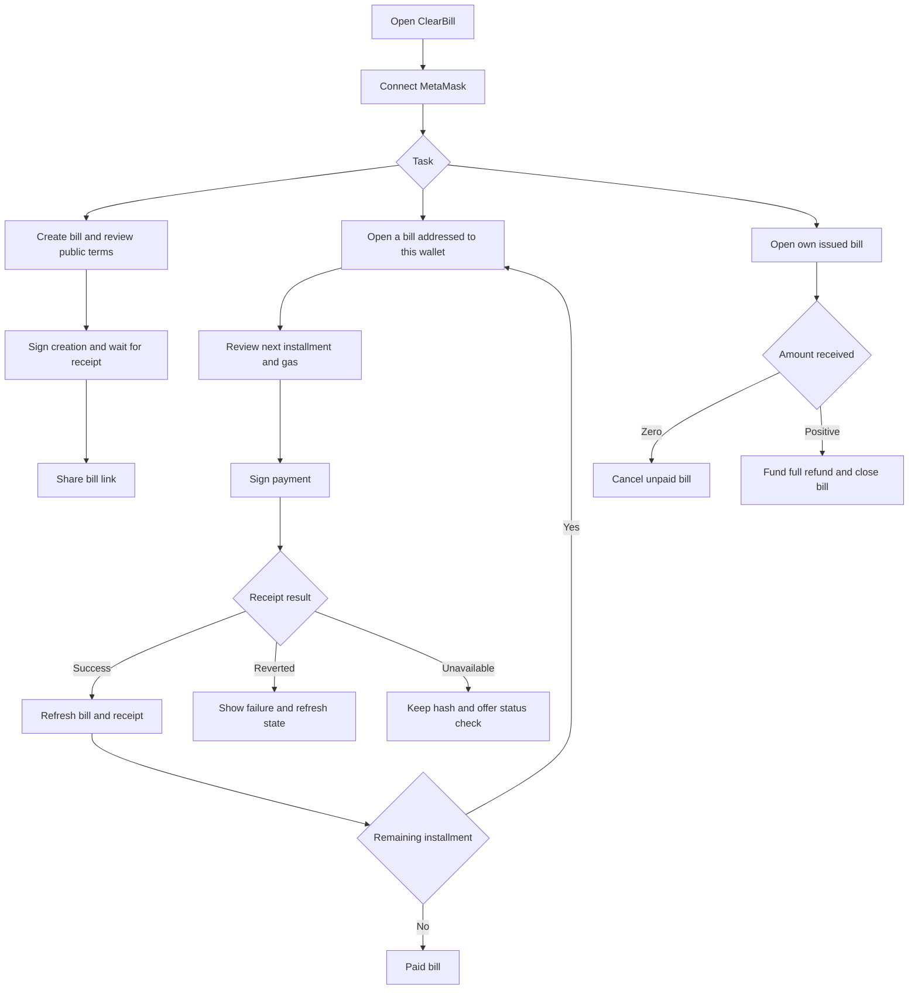

# ClearBill Product Requirements

Status: design baseline. Date: 16 October 2026.

## Problem and intended users

A freelance designer or developer may receive a deposit and a later balance payment through separate transfers. The parties then need to match transfers to the correct bill, determine the outstanding amount and trace any refund. ClearBill records these relationships under a stable bill ID and presents them through a mobile web interface.

The primary user is a freelancer collecting payments. The secondary user is the client paying a specified bill. One wallet can act in either capacity on different bills. There is no registration, administrator approval or identity verification.

Creating a bill does not prove that the payer accepted a debt or that work was delivered. A bill is a payment request. The application does not issue a tax invoice or certify a legal obligation.

## Objectives

1. Complete a single-payment or two-installment bill through a wallet-signed workflow.
2. Enforce payer, amount, sequence and lifecycle rules in the smart contract.
3. Support voluntary full refunds without holding customer funds between transactions.
4. Present trustworthy payment status, receipts and outstanding bill information on a small screen.
5. Demonstrate the required Solidity, MetaMask, backend, interface and testing integration with recorded evidence.

## Product decisions

| Area | Decision |
| --- | --- |
| Interface | English, mobile-first web layout; desktop remains usable |
| Network and currency | Sepolia test ETH; local development chain for automated tests |
| Architecture | One Solidity business contract, Node.js/Express, HTML/CSS/JavaScript |
| Settlement | Immediate transfer to the bill creator in the payment transaction |
| Payment schedule | One full payment or exactly two positive installments |
| Terms | Payer, label, amounts and deadlines cannot change after creation |
| Late payments | Allowed; overdue is a derived flag, not a terminal status |
| Cancellation | Creator only, before any payment |
| Refund | Creator funds a full refund of all payments received on that bill; bill closes |
| Privacy | Short public label only; no names, emails, attachments or contracts |
| Storage | Blockchain authority; no application database |
| Hosting | Render target; actual deployment remains pending |

## Modules

| ID | Module | Required behavior |
| --- | --- | --- |
| M1 | Wallet and account | Connect, display address/network/balance, react to account and chain changes |
| M2 | Bills | Create, list incoming/outgoing requests, inspect details, share a detail link, cancel |
| M3 | Installments | Choose one or two installments, show schedule, enforce exact next installment |
| M4 | Payments and transaction feedback | Review, sign, submit, reconcile receipt, report failure or uncertainty |
| M5 | Refunds | Review total received, return exactly that amount to the original payer, close bill |
| M6 | Receipts and history | View confirmed activity, filter by bill/type/time, export matching CSV records |
| M7 | Dashboard and overdue bills | Show gross received, refunded, net received and unpaid requested amounts |

## Business rules

- The connected creator becomes the immutable payee. The payer must be a nonzero address different from the creator and ClearBill itself.
- A public label must contain 1–80 UTF-8 bytes and must not be entirely whitespace in the interface. Treat it as plain text everywhere. Do not claim that every character represents one byte.
- For one payment, the amount is positive and its due time is in the future at contract execution. The unused second amount and deadline are zero.
- For two installments, both amounts are positive; the deposit due time is in the future and the balance due time is strictly later. Each amount is entered directly; the total is their checked sum.
- The payer may pay the next installment early or late. They cannot skip the deposit, pay an arbitrary fraction, overpay, or combine both installments in one call.
- A bill with no payments can be cancelled, including after its due time. A partially paid or fully paid bill can be refunded. A refund closes the bill and waives any unpaid remainder within this application.
- A refund is voluntary, initiated and funded by the payee. Gas spent on earlier transactions is not refunded. The application cannot debit a wallet or enforce a refund promise.
- A repeated payment request includes its expected installment index. If another payment already advanced the bill, the stale request must fail even when both installment amounts are equal.
- At exactly the due timestamp, a bill is not yet overdue. It is overdue when the chain timestamp is greater than the next unpaid installment's due time.
- An overdue deposit becomes a current balance obligation after deposit payment if the balance deadline has not passed. Overdue is recalculated rather than carried forward.
- Cancelled and refunded bills have zero actionable outstanding amount. Historical paid amounts remain available after a refund.
- A creator may issue more than one similar bill. No claim is made that the system prevents duplicate real-world billing. Submission references only prevent accidental retransmission of the same creation request.

## User flows

## Acceptance criteria

| ID | Acceptance condition |
| --- | --- |
| AC-01 | Wallet rejection, unavailable provider, disconnect, account change and wrong chain have distinct, recoverable interface states |
| AC-02 | Valid one-payment and two-installment bills can be created; invalid addresses, schedules, labels and amounts are rejected |
| AC-03 | Only the specified payer can pay the exact next installment; success updates state and transfers the correct amount |
| AC-04 | Skipped, repeated, overpaid, underpaid and stale installment calls revert without changing bill state |
| AC-05 | Early and late payment work; overdue calculations use the next unpaid deadline and chain time |
| AC-06 | Only the creator can cancel an unpaid bill; later payment and further cancellation are rejected |
| AC-07 | Only the creator can fund an exact full refund of received principal; original payer receives it and the bill closes |
| AC-08 | Transfer failure, reentrancy and payment/refund races cannot cause partial settlement or duplicate payment |
| AC-09 | Pending, successful, reverted, rejected, replaced and unknown transactions are distinguished; a hash alone never means success |
| AC-10 | Bill details and confirmed history can be reconstructed after refresh or backend restart without a database |
| AC-11 | Incoming/outgoing lists, per-bill history and bill/type/date filters return correctly scoped records; CSV export states its coverage |
| AC-12 | Dashboard arithmetic matches all relevant bills at one chain snapshot; incomplete scans are not presented as complete totals |
| AC-13 | Five screens work at 360 and 390 CSS pixels, without horizontal page overflow; forms and actions remain accessible |
| AC-14 | Backend validates inputs, verifies its network/deployment, provides real chain reads and reports dependency failure without fabricated empty results |
| AC-15 | Successful transaction, invalid input, real wallet connection and deployment evidence is retained with environment and date |
| AC-16 | Submission contains sources, setup instructions, screenshots and a 5–8 page report covering all required sections |
| AC-17 | No private keys or sensitive customer details are collected; public labels and voluntary refund limitations are explained before commitment |

## Scope exclusions

Escrow, delivery acceptance, arbitration, administrator permissions, legal debt confirmation, partial refunds, more than two installments, tokens, fiat conversion, lending, fees, email/SMS, uploaded files and customer contact storage are outside this release. They must not appear as working features in the report.

## Evaluation priorities

Smart contract design (20), DApp functionality (25) and backend integration (10) receive the first implementation effort. Interface (10) and testing (10) are acceptance gates, not finishing touches. Problem definition (10), report quality (10) and originality (5) are supported by the focused freelancer workflow, design rationale and actual evidence.

Reference repositories were used only to compare scope. Multi-contract financing, role registries and dispute workflows are excluded. No reference implementation, prose or directory layout is a project template.
