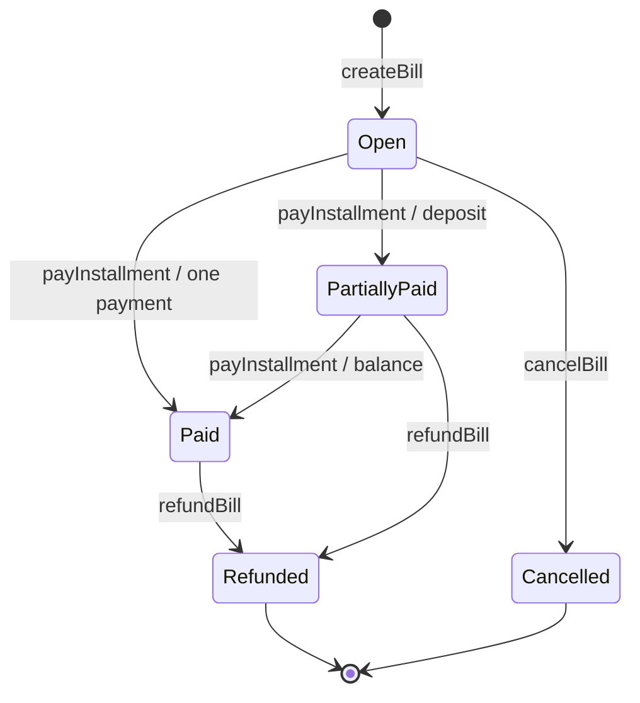

# ClearBill Smart Contract Design

Status: implemented, compiled and tested on a local Hardhat chain; Sepolia deployment remains pending. This document explains the contract interface. Code blocks are explanatory sketches; `contracts/ClearBill.sol` is authoritative.

## Responsibility and deployment

One contract owns bill terms, payment progress, cancellation and refund state. It forwards ETH during a payment or refund and retains no intentional customer balance between calls. There is no administrator, upgrade proxy, platform fee, token or withdrawal account.

Use a pinned stable Solidity 0.8.x compiler compatible with the chosen test tools. Record the exact compiler, optimizer and EVM target in the build configuration before compilation. Use the maintained OpenZeppelin `ReentrancyGuard`, pinned in the dependency lockfile, rather than a custom lock. This imported guard does not require another deployed business contract.

Deployment has no business constructor arguments. Initialize `nextBillId` to 1. The deployer receives no continuing privilege. The constructor is nonpayable.

## State model

```solidity
enum BillStatus { Open, PartiallyPaid, Paid, Cancelled, Refunded }

struct Bill {
    address payable payee;
    address payable payer;
    string label;
    uint256[2] amounts;
    uint64[2] dueAt;
    uint64 createdAt;
    uint8 installmentCount;
    uint8 paidInstallments;
    BillStatus status;
    uint256 paidAmount;
    uint256 refundedAmount;
}

uint256 public nextBillId;
mapping(uint256 => Bill) private bills;
mapping(address => uint256[]) private issuedBillIds;
mapping(address => uint256[]) private payableBillIds;
mapping(address => mapping(bytes32 => uint256)) private creationIds;
```

Amounts are integer wei. Times are Unix seconds. Installment indexes are zero-based in the contract and API; the interface displays installments 1 and 2. A zero payee marks an unknown bill; enum default `Open` must never be used as an existence check. `paidAmount` is lifetime gross receipts and is not zeroed after a refund.

The fixed arrays deliberately limit each bill to two installments. Per-address ID arrays support direct paginated reads without scanning the entire deployment. Only creation appends to them; cancellation and refunds never remove historical IDs. `creationIds` binds a random client submission reference to a creator and prevents duplicate creation after a lost confirmation.

## State transitions



`Paid` accepts a refund but no payment. Overdue is not an enum member: an open or partially paid bill is overdue when `block.timestamp > dueAt[paidInstallments]`. Cancelled, refunded and fully paid bills are never overdue.

## Function inventory

Every implemented function, constructor, receive handler and fallback handler must have an English purpose comment. Public functions use NatSpec to document parameters, permissions, amounts and return values.

| Function | Visibility | Value | Caller | Purpose |
| --- | --- | --- | --- | --- |
| `constructor()` | Constructor | Nonpayable | Deployer | Initialize first bill ID without assigning administrator rights |
| `createBill(...)` | External, nonReentrant | Nonpayable | Any wallet | Create immutable payment terms and return ID |
| `payInstallment(uint256,uint8)` | External, nonReentrant | Payable | Bill payer | Pay exactly the expected next installment |
| `cancelBill(uint256)` | External, nonReentrant | Nonpayable | Bill payee | Close a bill that has never received payment |
| `refundBill(uint256,uint256)` | External, nonReentrant | Payable | Bill payee | Return all received principal and close the bill |
| `getBill(uint256)` | External view | None | Anyone | Read one bill, reverting when absent |
| `getPaymentQuote(uint256)` | External view | None | Anyone | Return next index, amount and due time, or inactive quote |
| `getAccountBillCount(address,bool)` | External view | None | Anyone | Count issued or payable bills |
| `getAccountBillIds(address,bool,uint256,uint256)` | External view | None | Anyone | Read a bounded slice of account bill IDs |
| `getBillIdByReference(address,bytes32)` | External view | None | Anyone | Recover a creation result from its submission reference |
| `nextBillId()` | Generated external view | None | Anyone | Read the next ID; not proof that a particular bill exists |
| `receive()` | External payable | Rejected | Anyone | Reject direct ETH transfers outside business methods |
| `fallback()` | External payable | Rejected | Anyone | Reject unknown selectors and accidental ETH transfers |

## createBill

```solidity
/// @notice Creates a bill whose terms cannot be edited after submission.
function createBill(
    address payer,
    string calldata label,
    uint8 installmentCount,
    uint256[2] calldata amounts,
    uint64[2] calldata dueAt,
    bytes32 clientReference
) external nonReentrant returns (uint256 billId);
```

**Inputs and checks**

1. Payer is not zero, `msg.sender`, or `address(this)`.
2. Label length is 1–80 bytes. The client also trims and rejects whitespace-only labels; this presentation check is not a claim that the contract enforces Unicode semantics.
3. `installmentCount` equals 1 or 2.
4. First amount is positive; first due time is strictly greater than `block.timestamp`.
5. With one installment, both unused fields are zero. With two, second amount is positive and second due time is strictly later than the first.
6. The total fits `uint256`; use an explicit overflow check before addition for a named error.
7. `clientReference` is nonzero and unused for this creator. It is generated once for an intended submission and retained through confirmation recovery. A changed bill creates a new reference.

**Effects**: allocate and increment the ID, persist `Bill` with `Open`, zero paid counters and `createdAt`, append ID once to each party's array, save the creator/reference mapping, and emit `BillCreated`. No ETH or external call occurs. In a sent transaction the return value is not directly available to the browser; the browser extracts the ID from the matching event or reference lookup.

**Failure**: any check failure reverts all writes. Reuse of a reference returns `DuplicateReference(existingBillId)` rather than creating a second bill. Recovery reads that existing bill and compares terms; it must not silently treat a different bill as the intended result.

## payInstallment

```solidity
/// @notice Pays the specified next installment and forwards its value to the payee.
function payInstallment(uint256 billId, uint8 expectedInstallment)
    external payable nonReentrant;
```

**Checks**: bill exists; caller equals payer; status is `Open` or `PartiallyPaid`; expected index equals `paidInstallments` and is less than `installmentCount`; `msg.value` equals the stored amount for that index. Deadlines do not block payment.

**Effects before transfer**: increase `paidAmount`, increment `paidInstallments`, set `Paid` if all installments are paid, otherwise `PartiallyPaid`.

**Interaction**: call the immutable payee with exactly `msg.value`, never `address(this).balance`. On failure, revert with `TransferFailed(payee)`. On success, emit `InstallmentPaid` with index, amount and cumulative paid amount. A revert rolls back state, value transfer and logs; the sender still incurs any transaction gas actually spent.

The expected index is essential. If both installments are equal, resubmitting deposit index 0 after it succeeds must not be interpreted as payment of balance index 1.

## cancelBill

```solidity
/// @notice Cancels an unpaid bill without moving funds.
function cancelBill(uint256 billId) external nonReentrant;
```

**Checks**: bill exists; caller equals payee; status is `Open` and `paidAmount == 0`. This works before or after the deadline.

**Effects**: set `Cancelled`, emit `BillCancelled`. Do not remove the bill or edit its terms. Any later pay, refund or cancel call fails. If payment and cancellation compete, the first valid transaction in chain order determines the outcome: a successful payment prevents cancellation; a successful cancellation prevents payment.

## refundBill

```solidity
/// @notice Returns all received principal to the payer and closes the bill.
function refundBill(uint256 billId, uint256 expectedPaidAmount)
    external payable nonReentrant;
```

**Checks**: bill exists; caller equals payee; status is `PartiallyPaid` or `Paid`; stored paid amount is positive; `expectedPaidAmount == paidAmount`; and `msg.value == paidAmount`. No refund is permitted on an unpaid or closed bill.

**Effects before transfer**: set `refundedAmount = paidAmount`, set `Refunded`; preserve installment counters and lifetime paid amount.

**Interaction**: send exactly `msg.value` to the immutable payer. Revert the entire transaction if the payer rejects ETH. Emit `BillRefunded` only on success. The payee supplies the refund from their wallet and pays the new transaction's gas.

**Payment/refund race**: if a balance payment executes first, a refund prepared for the deposit alone fails with `StalePaidAmount`. The payee must review the new total and approve a new request. If a refund executes first, the balance payment fails because the bill is closed. Do not auto-resubmit either action with changed value.

## Read functions

```solidity
/// @notice Returns the stored terms and lifetime settlement counters for a bill.
function getBill(uint256 billId) external view returns (Bill memory);

/// @notice Returns the next payment terms and overdue flag without authorizing payment.
function getPaymentQuote(uint256 billId) external view returns (
    bool payableNow, uint8 installmentIndex, uint256 amount,
    uint64 dueAt, bool overdue
);

/// @notice Counts bills created by or addressed to an account.
function getAccountBillCount(address account, bool asPayee)
    external view returns (uint256);

/// @notice Returns a creation-ordered account bill slice and the next offset.
function getAccountBillIds(address account, bool asPayee, uint256 offset, uint256 limit)
    external view returns (uint256[] memory ids, uint256 nextOffset, uint256 total);

/// @notice Finds a bill created with a given account-scoped submission reference.
function getBillIdByReference(address creator, bytes32 clientReference)
    external view returns (uint256);
```

- `getBill` and `getPaymentQuote` revert for an unknown ID. `getPaymentQuote` returns `(false,0,0,0,false)` for Paid, Cancelled or Refunded; consumers must check the boolean. It is a state quote, not proof that a particular caller is authorized or has sufficient balance.
- Account queries reject the zero address. `asPayee=true` selects issued bills; false selects requests addressed to the account.
- Slice limit is 1–50 to bound response size. Offset may equal total, yielding empty IDs and `nextOffset=total`; greater offsets revert. IDs are oldest first. Reads never return all stored bills in one unbounded loop.
- Reference lookup returns zero if absent. Validate creator is nonzero and reference is nonzero; a missing reference is not a transaction failure.
- No `getAllBills`, `getAllHistory`, dashboard aggregation, search or CSV method belongs in the contract.

## Internal methods

| Method | Intended signature | Responsibility |
| --- | --- | --- |
| `_requireBill` | `(uint256 billId) internal view returns (Bill storage)` | Return existing storage reference or `BillNotFound` |
| `_validateTerms` | `(address payer,string calldata label,uint8 count,uint256[2] calldata amounts,uint64[2] calldata dueAt) internal view` | Enforce creation address, byte length, schedule and sum rules |
| `_sendEther` | `(address payable recipient,uint256 amount) internal` | Execute one value call and revert on failure; only called after state updates inside guarded methods |

Keep other checks in their owning methods unless implementation shows meaningful reuse. No generic authorization framework is needed. Public read functions reuse `_requireBill` as appropriate. View calls during a recipient callback may observe post-update state; this must not authorize an external action or permit another mutating entry point to bypass the guard.

## Events

```solidity
event BillCreated(
    uint256 indexed billId, address indexed payee, address indexed payer,
    bytes32 clientReference, uint256 totalAmount, uint8 installmentCount
);
event InstallmentPaid(
    uint256 indexed billId, address indexed payee, address indexed payer,
    uint8 installmentIndex, uint256 amount, uint256 cumulativePaid
);
event BillCancelled(
    uint256 indexed billId, address indexed payee, address indexed payer
);
event BillRefunded(
    uint256 indexed billId, address indexed payee, address indexed payer,
    uint256 amount
);
```

The same three indexed fields support bill and account history filters. Labels and schedules are available from `getBill`; do not duplicate the full struct in events. A receipt/event's block supplies its timestamp, block hash and transaction identity. Persist no transaction hash inside the contract.

## Errors

| Error signature | Trigger and interface response |
| --- | --- |
| `BillNotFound(uint256 billId)` | Unknown bill; show not found |
| `InvalidAddress(address account)` | Zero, self-payment or contract-as-payer where prohibited; correct address |
| `InvalidLabelLength(uint256 length)` | UTF-8 label length outside range; shorten or enter label |
| `InvalidInstallmentCount(uint8 count)` | Count other than 1 or 2 |
| `InvalidAmount(uint8 index)` | Required positive amount is zero |
| `InvalidSchedule()` | Past first deadline, reversed deadlines or nonzero unused terms |
| `TotalAmountOverflow()` | Sum exceeds uint256 |
| `InvalidReference()` | Zero submission reference |
| `DuplicateReference(uint256 existingBillId)` | Creation retry; recover and compare existing bill |
| `Unauthorized(address caller)` | Caller does not hold required bill role |
| `InvalidStatus(uint256 billId,BillStatus status)` | Operation not allowed for stored lifecycle |
| `UnexpectedInstallment(uint8 expected,uint8 actual)` | Submitted index differs from next index; refresh schedule |
| `IncorrectValue(uint256 required,uint256 supplied)` | Value differs from exact payment/refund amount |
| `StalePaidAmount(uint256 expected,uint256 actual)` | Refund reviewed amount differs from current received amount |
| `TransferFailed(address recipient)` | Recipient rejected ETH; state remains unchanged |
| `InvalidPagination()` | Invalid limit or offset |
| `DirectTransferNotAllowed()` | Plain ETH transfer to contract |
| `UnsupportedCall()` | Unknown function selector |
| `ReentrancyGuardReentrantCall()` | Guard rejects recursive mutation; inherited library error |

For `UnexpectedInstallment`, expected is the index supplied by the caller and actual is the stored next index. For `StalePaidAmount`, expected is the caller's reviewed amount and actual is the stored paid amount. ABI encodings of enum values use their numeric representation. Compiler-enforced nonpayable rejection and arithmetic panics remain possible; the UI needs a safe generic revert message for unrecognized errors.

## Permission matrix

| Operation | Payee | Payer | Other address |
| --- | --- | --- | --- |
| Create independent bill | Yes | Yes | Yes |
| Read any bill/history | Yes | Yes | Yes |
| Pay this bill | No | Yes, valid next installment | No |
| Cancel this bill | Yes, unpaid only | No | No |
| Refund this bill | Yes, paid principal only | No | No |
| Edit terms or erase records | No | No | No |

Authorization uses `msg.sender`, not a supplied HTTP address or `tx.origin`. The website filtering a wallet's bills is convenience, not privacy protection.

## Invariants and verification

| ID | Invariant | Required test |
| --- | --- | --- |
| INV-01 | `0 <= paidInstallments <= installmentCount <= 2` | Every success and failure transition |
| INV-02 | `paidAmount` equals the sum of completed installment amounts | Single, deposit, balance, failed transfer |
| INV-03 | `Open` has zero paid; `PartiallyPaid` has one of two; `Paid` has all | Transition and stale-call tests |
| INV-04 | Refunded amount is zero except in `Refunded`, where it equals lifetime paid | Partial/full-bill refunds and duplicate attempts |
| INV-05 | Successful payment forwards its exact value once; successful refund does likewise | Recipient balance deltas and malicious receivers |
| INV-06 | Failed external transfer leaves the complete prior state intact | Rejecting payee and payer contracts |
| INV-07 | Terms, identities and creation reference never change | Before/after all lifecycle operations |
| INV-08 | Terminal Cancelled/Refunded cannot reopen or receive payments | All mutators against closed bills |
| INV-09 | Stale index or stale refund amount cannot spend on updated terms | Equal-sized installments; both race orderings |
| INV-10 | Account indexes contain each created ID exactly once | Multiple creators/payers, creation retry |

Do not assert that the contract balance is always zero: ETH can be forced into it. Such ETH must never change bill accounting and has no recovery method in this release. Document this residual limitation rather than adding an administrator withdrawal.

No loops over historical bills occur in payable functions. Measure creation, single payment, deposit, balance, cancellation and refund gas from actual receipts. Record compiler settings with measurements; do not publish invented cost estimates as test results.

## Design trade-offs

Direct settlement eliminates long-lived escrow balances but means a recipient that rejects ETH can block its own settlement. A pull-payment design would add custodial balances and withdrawal transactions; it is outside the accepted direct-settlement scope. Full refunds are simpler than arbitrary refund accounting and deliberately close the unpaid remainder. Public terms aid reconciliation but reveal financial relationships.

The security rationale follows the Solidity guidance on external calls, checks-effects-interactions, public chain data and bounded loops: [Solidity security considerations](https://docs.soliditylang.org/en/latest/security-considerations.html). These precautions do not constitute a security audit.
